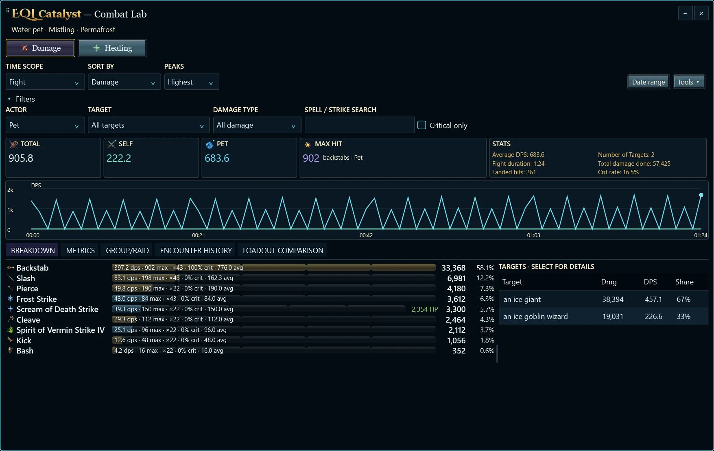

# EQL Catalyst — Beta 1.1

An independent Windows companion for **EverQuest Legends**: follow combat, organize quests, and compare Gear and Pet builds using local game evidence.

[**Download Beta 1.1**](https://github.com/Runelaron/EQL-Catalyst/releases/tag/v1.1.0-beta.1) · [Screenshots & installation](https://runelaron.github.io/EQL-Catalyst/) · [Installation help](docs/installation.md) · [Report an issue](https://github.com/Runelaron/EQL-Catalyst/issues)



## Features

- **DPS and healing:** compact overlays, Pet/Self/Combined/Group displays, contextual icons, independent filters, and smooth presentation.
- **Combat Lab:** breakdowns, charts, peaks, retained encounters, login sessions, class filters, exports, and Group/Raid member details with verified pet attribution.
- **Quest planning:** a saved queue, item and quest discovery, walkthroughs, required components, ownership evidence, and reversible progress.
- **Gear:** Current and named builds, autosave and Undo, inventory reconciliation, valid-slot dragging, classic item details, rank previews, and transparent preference formulas.
- **Pets:** summon and focus evidence, automatic/manual level context, equipment eligibility, expansion filters, inventory planning, comparisons, and isolated Theorycraft builds.
- **Exaltations:** effect/source search, compatibility and unlock rules, ownership/storage evidence, and current/future content filtering.
- **Local-first data:** offline catalogs and saved sessions, resumable log reading, complete inventory captures, and optional verified native-hotkey sync.
- **Appearance:** Coldain, Sunstrider, Shadowman, Auto, Clean/Vibrant icons, selectable damage emblems, race-inspired tabs, transparency, and menu density.

Scores are preference points, **not predicted DPS**. Missing or disputed mechanics stay labeled. Class Loadout comparison is in development. Live-game interaction and physical-monitor DPI acceptance remain separate from automated tests.

Beta 1.1 adds cascading panel/column resizing, visible handles, whole-app character switching, clearer visual appearance selectors, customizable overlay shortcuts, and a deeper Shadowman theme. See [release notes](CHANGELOG.md), [appearance and shortcuts](docs/compact-settings.md), and [character/layout controls](docs/cascading-controls.md).

## Install

Windows x64; no separate .NET installation is required. Setup defaults to **Install for me** in `%LOCALAPPDATA%\Programs\EQL Catalyst`; the optional all-users choice uses native `Program Files`. The installer is **unsigned**: Windows may warn or block it under local policy. Verify the published checksum; do not disable security protections.

Choose a game folder and character on first launch, or leave the game folder blank for offline use. The last opened profile is remembered. New profiles start with unknown facts, and automatic capture remains off until explicitly enabled and verified. Character data stays in `%LOCALAPPDATA%\EQLTracker` and survives uninstall.

## Build and test

Install the .NET SDK pinned by `global.json`, Python 3, and the verified Inno Setup compiler. On Windows:

```powershell
dotnet run --project tests/EqlTracker.Tests -c Release
python scripts/build-release.py --bootstrap-compiler
```

The build script downloads a checksum-pinned, publisher-verified Inno Setup **7.1.0** compiler, builds a self-contained Windows x64 payload, and creates installer, portable and source archives. It never publishes or touches game/profile files. Use `--compiler` and `--dotnet` to select existing tools. See [release checks](docs/release-checks.md).

## Licensing and credits

Application code and first-party project material: **GPL-3.0-only**, copyright 2026 Runelaron. See [LICENSE](LICENSE). Wiki-derived content remains **CC BY-SA 4.0**, the bundled font remains **SIL OFL 1.1**, and dependencies keep their own licenses. See [third-party notices](THIRD-PARTY-NOTICES.md) and [artwork notices](ASSET-NOTICES.md).

EQL Catalyst is an independent community companion, not an official Daybreak, Darkpaw, or Game Jawn product. EverQuest and other referenced characters/trademarks remain the property of their respective owners.
